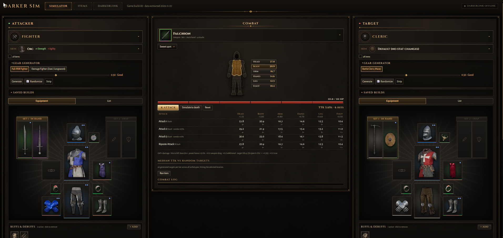

# Darker Sim

A Dark and Darker companion: a loadout and stat calculator, damage bench and time-to-kill simulator (Rust → WebAssembly), plus the tools that build its database from the game files.



## This repository contains no game data

There are **no files, data or assets from Dark and Darker** in this repository: no item data, icons, texts or extracted files. The one exception is the screenshot above (`docs/screenshot.png`), which shows game icons owned by IRONMACE. The simulator can't run until that data is generated.

To generate it you need **your own Dark and Darker install**. `scripts/update.ps1` reads the installed game files (read-only, offline) and writes the data locally:

- `app/data/game.json`: the game database the simulator loads
- `data/icons/`: item, ability, buff, class and skin icons
- `data/builds/`, `data/changelogs/`, `data/wiki/`, `data/raw/`: intermediate files and patch history

All of these paths are in `.gitignore` and must never be committed.

> **We advise against running the extractor.** Reading and exporting game files may be against IRONMACE's terms of service. The tools are here so the project is complete and reviewable. If you run them anyway, you do so at your own risk, on your own copy of the game, and the data you generate is subject to IRONMACE's terms. Never share or publish it.

### What the extractor needs (not included)

- .NET 10 SDK, Python 3, Rust with `rustup target add wasm32-unknown-unknown`
- `tools/CUE4Parse/`: a clone of the upstream [CUE4Parse](https://github.com/FabianFG/CUE4Parse) parser, which `tools/DadExtractor` builds against
- `tools/mappings/*.usmap`: a mappings file for the current game version (the newest one is used)
- `tools/bin/trunk.exe`: [trunk](https://trunkrs.dev) for building the web app (or trunk on your `PATH`)

## After every game patch

```powershell
pwsh scripts/update.ps1            # generate the data locally
pwsh scripts/update.ps1 -Publish   # same, then copy it to the private data repo (maintainers only)
```

`update.ps1` does the following:
1. Reads the build number from `UpdateVersion.dat` (e.g. `build-80`).
2. Lists every file in the game containers into `data/raw/<build>/_filelist.tsv`.
3. Exports the data assets under `Data/` to JSON in `data/raw/<build>/`.
4. Exports the icons to `data/icons/`.
5. Refreshes the wiki cache (`data/wiki/`, for English names and prices).
6. Builds `data/builds/<build>.json` plus `app/data/game.json`.
7. Diffs against the previous build and writes `data/changelogs/<old>_to_<new>.md`.

Options: `-Force` re-extracts the same build, `-SkipWiki` skips the network, `-GameDir` / `-UeVersion` / `-Mappings` handle a moved install or an engine bump.

`scripts/publish-data.ps1` (run by `-Publish`) mirrors the generated folders into the maintainers' private data repo and pushes them. It refuses to run against any other repo.

## How easy are the game files to read?

| Layer | Status |
|---|---|
| Containers (`.utoc/.ucas`, IoStore) | **Not encrypted**; Oodle-compressed. Readable directly. |
| Legacy `.pak` index | AES-encrypted. It holds localization (`.locres`), which is why English names come from the wiki. |
| Engine | Unreal **5.6** (detected from the package header layout). |
| Properties | *Unversioned*, so decoding needs a `.usmap` mappings file. Put one in `tools/mappings/` (not included; community archives exist, e.g. TheNaeem/Unreal-Mappings-Archive). |
| Decode rate | ~92% of data assets. Items, stats, recipes, curves, classes, perks, skills, spells, buffs and constants are fine. Systems added after Dec 2025 (Workshop, merchant buy prices, quests, spawners) need a newer usmap; see the **Data** tab. |

The data is clean, one asset per row: `Data/Generated/V2/Item/Item/Id_Item_Longsword_5001` → rarity, slot, hand type; `ItemProperty/Id_ItemProperty_Primary_Longsword_5001` → 46–48 physical weapon damage, −40 move speed; `Merchant/StockCraft/*` → recipes; `Data/GameplayAbility/CT_*` → attribute → stat curves; `ActorStatus/StatusEffect/*` → buff values.

**Caveat:** buff field names don't match their meaning (`PhysicalDamageAdd` on a status effect is Physical Power **Bonus %**). `scripts/build_db.py` holds a calibrated mapping (`STATUS_FIELDS`) checked against wiki-tested abilities. Each buff is marked `verified` or `inferred`.

## Layout

```
sim/                   simulator: dad-core (engine) and dad-web (UI)
tools/DadExtractor/    headless exporter (C#, .NET 10)
tools/DarkerLink/      Windows companion app (tooltip capture)
scripts/update.ps1     the data pipeline
scripts/publish-data.ps1  copies generated data to the private data repo
scripts/build_db.py    raw JSON -> normalized DB
scripts/diff_builds.py patch changelog
scripts/fetch_wiki.py  wiki enrichment cache
scripts/sim.ps1        build or serve the simulator
data/archetypes.json   build presets (our own)
app/                   the older plain-JS companion page (loads app/data/game.js)
Dockerfile, deploy/    static-site build (see DEPLOY.md)
```

Generated locally and never committed: `app/data/`, `data/icons/`, `data/builds/`, `data/changelogs/`, `data/wiki/`, `data/raw/`, `tools/CUE4Parse/`, `tools/mappings/`, `tools/bin/`.

## Sources of truth

- **Game files:** item stats per rarity, class requirements, enchant pools, recipes, class attributes, perks/skills/spells, buff values, scaling curves, constants (hitbox multipliers, caps).
- **Code-side formulas** (not in the data): hybrid stat weights (Health rating = 0.25 STR + 0.75 VIG, Action speed rating = 0.25 AGI + 0.75 DEX, Regular interaction rating = 0.25 DEX + 0.75 RES) and the damage formula structure. These are calibrated against in-game readings.
- **Wiki** (spellsandguns): English names, sell prices, inventory size and some melee combo data, fetched into the local `data/wiki/` cache.

## Simulator (Rust → WebAssembly)

```powershell
pwsh scripts/sim.ps1          # builds and serves http://127.0.0.1:8080
```

- `sim/crates/dad-core`: the engine (stats, weapon/spell damage, DoT ticks, time to kill, gear generator). It is pure Rust with unit tests (`cargo test -p dad-core`), and the same code can run inside a later desktop (Tauri) build.
- `sim/crates/dad-web`: the Leptos UI. It loads `app/data/game.json` and `data/archetypes.json` at startup, so after a patch you only rerun `update.ps1`.
- **Items page + tooltips:** every item's real in-game icon, extracted by `DadExtractor icons` (1.4k textures to WebP, a few seconds) and matched to items through their art data (`DadExtractor artmap`). `update.ps1` refreshes them each patch. Hovering any item, in the browser or on equipped gear, shows an in-game style tooltip with exact rolls and enchants.

## DarkerLink (add items straight from the game)

`tools/DarkerLink` is a small Windows tray app. Hover an item in Dark and Darker (inventory, stash, your
equipped gear) and press **Ctrl+Alt+A** to put it on the simulator's Attacker, **Ctrl+Alt+T** for the Target.

- It screenshots the area around the cursor, reads the tooltip with the built-in Windows OCR, and sends the
  text lines (with colours: blue = enchantment, name colour = rarity) to Darker Sim over `localhost:47321`.
  It never reads game memory or sends input to the game.
- Darker Sim (`dad_core::tooltip`) matches the item, rarity, base roll and enchantments and equips it. Items the
  class can't normally use are still equipped, with a red "Doesn't fit <class>" overlay.
- The result shows as a small in-game toast (game must be in Borderless/Windowed mode to see it).
- Build/run: `dotnet build tools/DarkerLink -c Release`, then
  `tools/DarkerLink/bin/Release/net10.0-windows10.0.19041.0/DarkerLink.exe`.
- Settings (hotkeys, capture size): `%APPDATA%\DarkerLink\config.json`. The last 40 captures (PNG + OCR JSON)
  are kept in `%APPDATA%\DarkerLink\captures` for tuning; re-send one with
  `curl -X POST --data-binary @capture.json http://localhost:47321/replay`.

## Notice

This is an unofficial fan project, made for fun. It is not affiliated with, endorsed by or connected to IRONMACE, the
developer of Dark and Darker. Dark and Darker and everything that belongs to it (names, item and ability icons, game
data and other game assets) is the property of IRONMACE; we claim no ownership of it and all credit for the game goes
to IRONMACE. **No game files, data or assets are included in this repository**, apart from the screenshot in `docs/`, which shows game icons. All UI art is our own.

IRONMACE™ and Dark and Darker™ are trademarks of IRONMACE in the U.S. and/or other countries. Certain assets and
content used by this project are © IRONMACE. All rights reserved.
